# AI-Driven 3D Architectural Reconstruction: Front-End Showcase

A browser-based platform that turns 2D photos of demolished or ruined historic buildings into interactive 3D models. No 3D-modelling expertise is needed: upload photos, guide the building mask, follow reconstruction progress live, and explore the result in the browser.

BU Spark! Practicum · DS 549 · Spring 2026 · Grade: A

  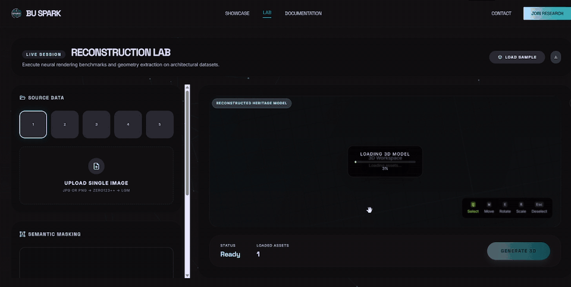

> Source code is not published. This repository is a visual showcase of the front end.

---

## Features

### Home / Project showcase
A landing page with an animated 3D background. It introduces the project's mission of preserving architectural heritage and walks visitors through the reconstruction workflow, from photo upload to an interactive 3D model.

  

  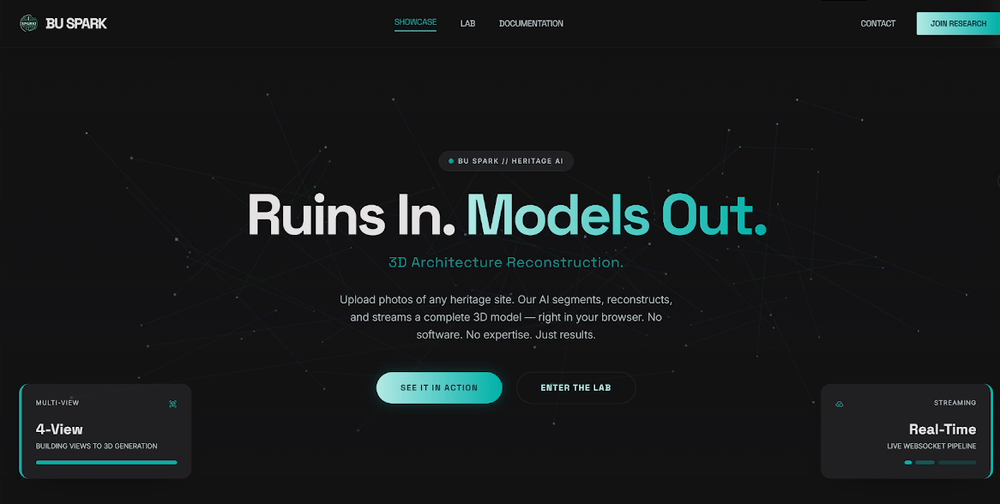
  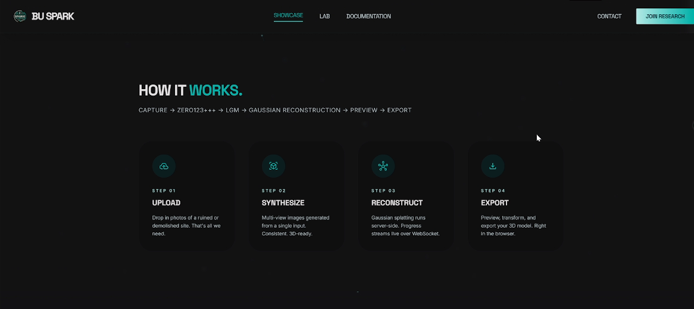

### Tech stack section
A section of the home page that lists the technologies behind the platform and the project's next steps.

  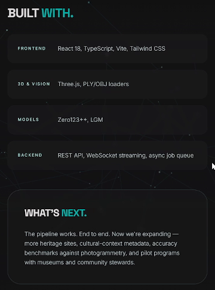

### Multi-image reconstruction workspace
The main interactive workspace. Users load site photos into five source slots and guide an AI segmentation model with positive/negative clicks and bounding boxes to isolate the building from its surroundings. They then start a reconstruction job. Progress streams into the page in real time while the back end does its work.

  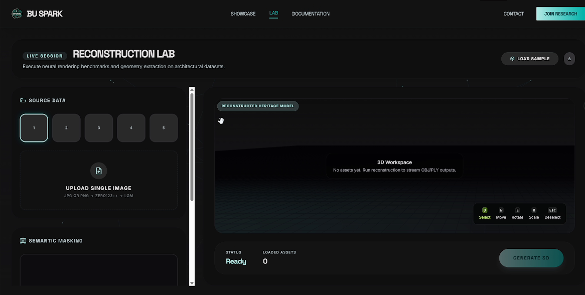
  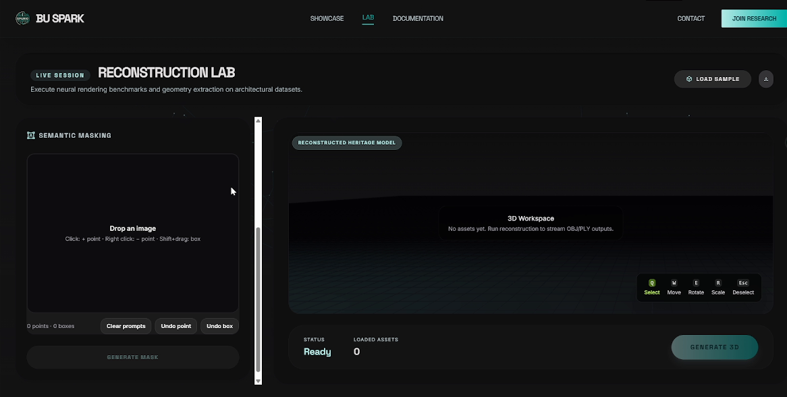

  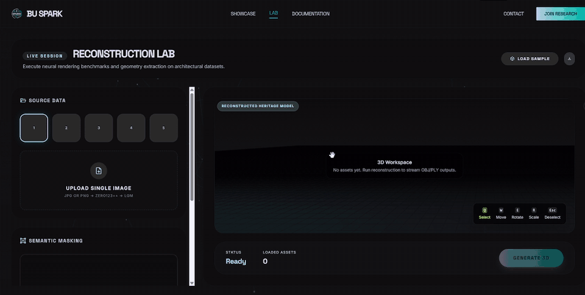

### Interactive 3D preview
The reconstructed model loads directly in the browser. Users can orbit and zoom around it, and select, move, rotate or scale models in the scene.

  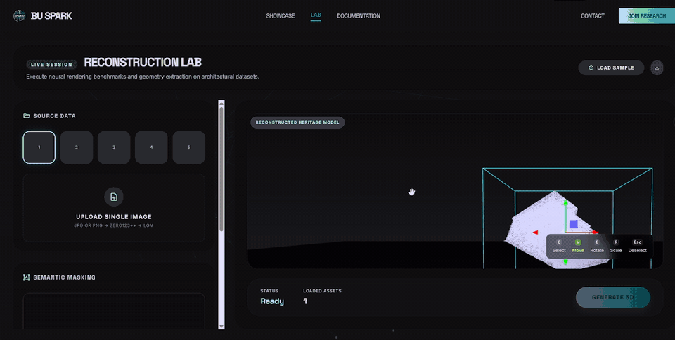

  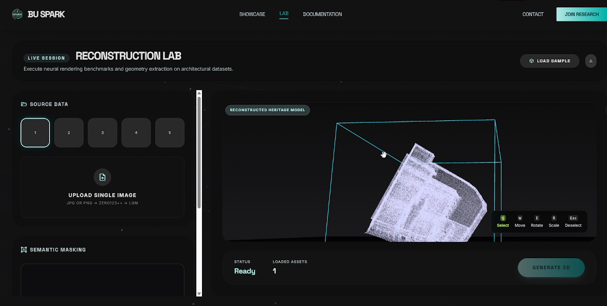
  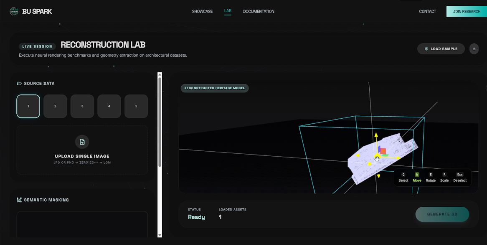

### Documentation pages
In-app pages that explain how the reconstruction pipeline works and record our early exploration with neural radiance fields (Nerfstudio) and structure-from-motion (COLMAP).

  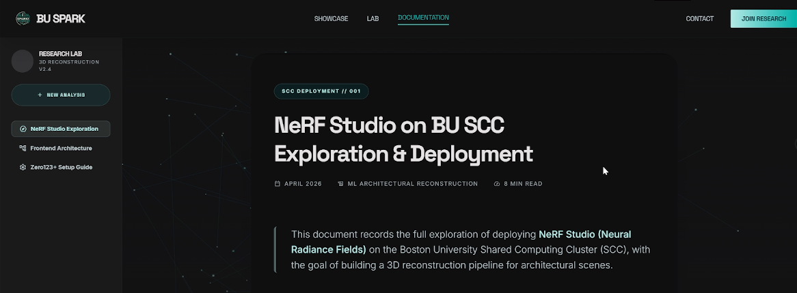

---

## Tech stack

React · Three.js · WebSockets · REST · Nerfstudio · COLMAP · Hugging Face Spaces

## My role

I built the front end (UI, 3D viewer, and integration with the back-end job events). The back-end reconstruction service was built by a teammate.

Early in the project I also explored NeRF-based reconstruction with Nerfstudio and COLMAP on BU's GPU cluster.

---

## 中文说明

这是 2026 年春季 BU Spark! 实践课（DS 549）的客户项目（成绩 A）：一个从 2D 照片重建已损毁历史建筑 3D 模型的网页平台。

我负责整个前端：
- 带 3D 动态背景的首页和项目展示
- 重建工作台：多图上传，用正负点击点和框选引导 AI 分割
- 通过 WebSocket 实时显示重建进度
- 基于 Three.js 的浏览器内 3D 交互预览（旋转、缩放、移动模型）

项目早期，我还在 BU GPU 集群上做过 Nerfstudio / COLMAP 的 NeRF 重建探索。后端重建服务由队友完成。

本仓库只做界面展示，不包含源代码。
